<div align="center">

# ⚡ N E X U S

### One desktop. Every AI. Zero tab chaos.

[](https://github.com/a1sadeq/nexus/releases/latest)
[](https://github.com/a1sadeq/nexus/releases/latest)
[](LICENSE)
[](https://www.electronjs.org/)
[](https://react.dev/)
[](https://www.typescriptlang.org/)

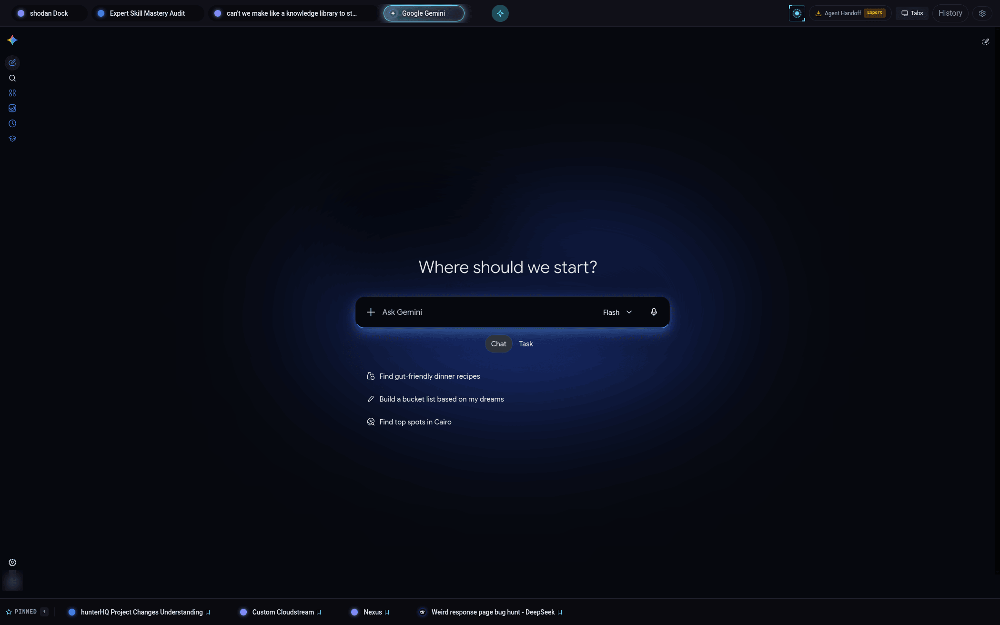

**Gemini · Qwen · Kimi · DeepSeek · Perplexity · Google AI Studio · Arena · Z.ai — one window, one history, one keyboard.**

[**Download for Windows**](https://github.com/a1sadeq/nexus/releases/latest) · [Arch Linux](#arch-linux) · [Build from source](#build-from-source) · [Feature guide](#feature-guide) · [Troubleshooting](#troubleshooting)

</div>

---

## What Nexus is

Nexus is a desktop cockpit for the AI tools you already use. Instead of juggling a dozen browser tabs, you get one dark, keyboard-driven workspace with shared tabs, a pinned chat dock, a unified history, reusable skills, and a one-click context handoff between providers.

It is **not** an API client and **not** a proxy. Each provider runs its real web app inside an isolated Electron webview, so your sessions, attachments, model pickers, and features behave exactly as they do in the browser. Nexus adds the workspace around them.

> **New in v1.0.2:** a rebuilt Windows installer, hardened tab lifecycle, fixed Export Context engine, live feature hooks, a bottom pinned dock by default, and this guide.

---

## Install on Windows

**Requirements:** Windows 10 or 11, 64-bit. 8 GB RAM recommended.

1. Open the [latest release](https://github.com/a1sadeq/nexus/releases/latest) and download **`nexus-1.0.2-setup.exe`**.
2. Run the installer. It installs **per-user**, so Windows does not ask for administrator rights.
3. If **Windows SmartScreen** says *"Windows protected your PC"*:
   - Click **More info**.
   - Click **Run anyway**.
   - This appears because the installer is not code-signed. The SHA-256 hash is published below so you can verify the file.
4. Launch **Nexus** from the Start Menu.
5. Sign in to each provider once. Nexus keeps those sessions in its own profile.

**Verify your download (PowerShell):**

```powershell
Get-FileHash .\nexus-1.0.2-setup.exe -Algorithm SHA256
```

Expected for v1.0.2:

```text
ce152c15fa6d33ff6131251299102eff1c08e2d57209c4276a5cf274455d1d20
```

### Where Windows puts things

| What | Path |
| --- | --- |
| App install | `%LOCALAPPDATA%\Programs\nexus` |
| Settings, sessions, skills | `%APPDATA%\nexus` |
| Downloads from AI pages | `%USERPROFILE%\Downloads\nexus` |

---

## Arch Linux

```bash
sudo pacman -U nexus-1.0.2.pacman
nexus
```

SHA-256 for `nexus-1.0.2.pacman`:

```text
fde9095ba1653b101e0e4418b345f8082ac3ed2cf2f8c381751f77cc6d5b9d6b
```

Config and sessions live in `~/.config/nexus`. Downloads land in `~/Downloads/nexus`.

---

## Build from source

**Requirements:** Node.js 22+, npm, and the usual Electron build dependencies for your OS.

```bash
git clone https://github.com/a1sadeq/nexus.git
cd nexus
npm ci
npm run dev
```

Build installers:

```bash
npm run build:win     # Windows NSIS installer
npm run build:linux   # Arch .pacman package
npm run build:mac     # macOS (unsigned)
```

---

## Your first five minutes

1. **Open the model launcher** with `Ctrl+T`, pick a provider, and sign in.
2. **Pin the chats you live in** with `Alt+P`. Pinned chats sit in the bottom dock by default.
3. **Open the built-in guide** with `F1`. It walks through themes, providers, skills, and shortcuts.
4. **Open the Skills palette** with `Ctrl+S` and run a skill on the active chat.
5. **Export a handoff** with `Ctrl+Shift+E` when a conversation outgrows one model.

---

## Feature guide

<details>
<summary><b>Multi-provider cockpit</b> — eight providers, one tab strip, one history</summary>

<br />

Nexus ships with eight providers already configured:

**Gemini · Qwen · Kimi · DeepSeek · Perplexity · Google AI Studio · Arena · Z.ai (GLM)**

- `Ctrl+T` opens the model launcher with live provider history.
- `Ctrl+]` and `Ctrl+[` rotate forward and backward through providers.
- `Ctrl+H` searches one unified history across every provider.
- Add any other provider in **Settings → AI Providers**: name, URL, color, icon, and description. ChatGPT, Claude, Grok, Mistral, or an internal tool all work the same way.
- Each provider remembers its own zoom, theme overrides, and DOM hooks.

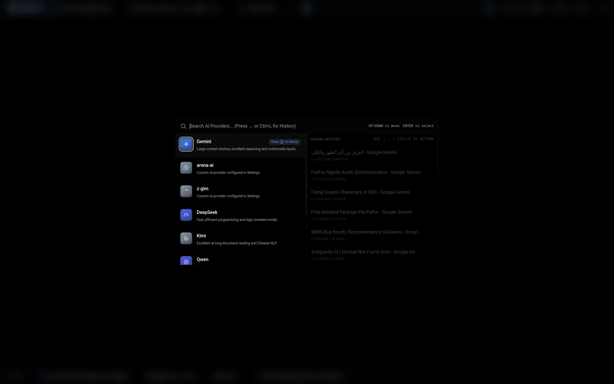

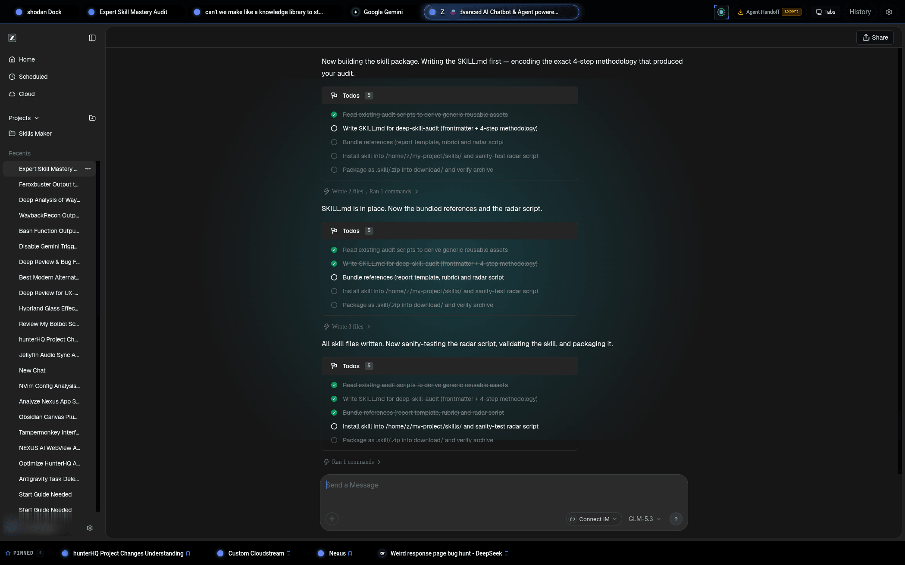

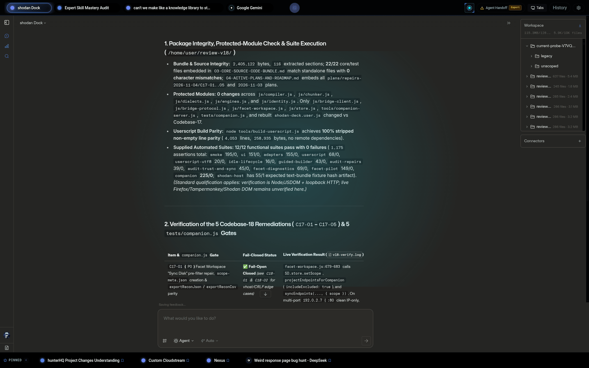

</details>

<details>
<summary><b>Pinned dock</b> — keep the chats you use, hide the rest</summary>

<br />

Pin a chat with `Alt+P`. Pinned chats move into a persistent dock instead of competing with normal tabs.

- The dock sits at the **bottom** by default in v1.0.2.
- Prefer the old layout? **Settings → General → Pinned Chats Position → Sidebar**.
- `Ctrl+B` collapses or expands the dock.
- Pinned chats survive tab cleanup and are never auto-discarded.

</details>

<details>
<summary><b>Tab memory control</b> — stop twenty AI tabs from eating your RAM</summary>

<br />

AI web apps are heavy. Nexus can put idle tabs to sleep without losing them.

- **Settings → General → Tab Discard System**.
- Default: discard a tab after **10 minutes** of inactivity.
- **Max active tabs** limits how many stay loaded at once (`0` = unlimited).
- Pinned tabs are protected. Tabs without a safe restore URL are also protected.
- Click a discarded tab and it reloads its last URL.
- **Tab Overview** (`Ctrl+Shift+A`) lets you search, filter, and preview every open tab.

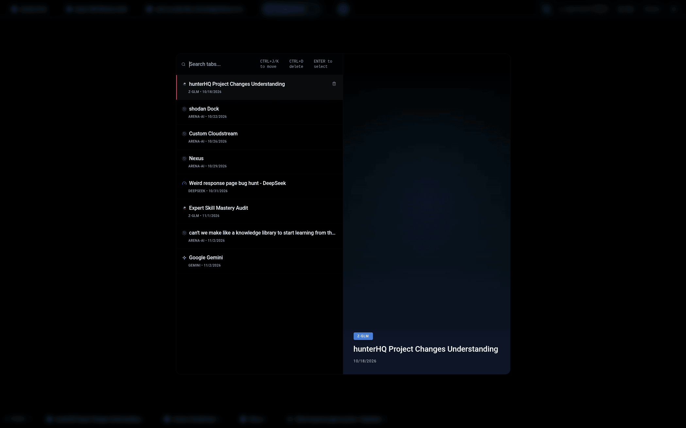

</details>

<details>
<summary><b>Sessions &amp; cookie sync</b> — fix the "Google blocked this browser" problem</summary>

<br />

Some providers refuse to sign in inside an embedded webview. Nexus can import the session your real browser already has.

1. Close the browser you want to import from. Its cookie database is locked while it runs.
2. Open **Settings → General → Account Sessions & Cookie Sync**.
3. Pick a detected browser profile, or paste exported cookie JSON.
4. Nexus imports cookies for Google, OpenAI, Anthropic, Perplexity, DeepSeek, xAI, Mistral, and Z.ai.

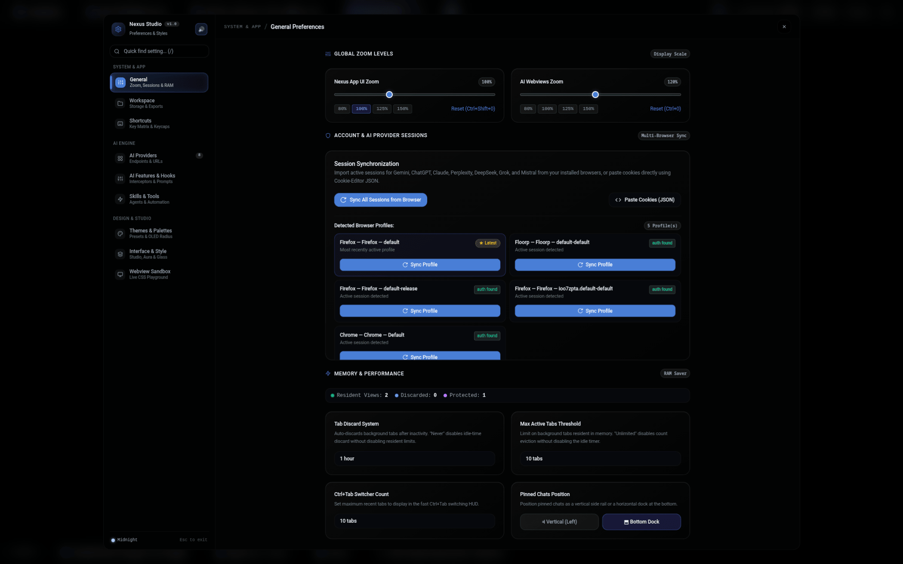

</details>

<details>
<summary><b>Skills engine</b> — 39 reusable prompts, parameters, and framework rules</summary>

<br />

Skills turn a good prompt into a repeatable tool.

- `Ctrl+S` opens the **Skills & Tools Palette**. Search, filter by category, or type a slash command.
- `Ctrl+Shift+S` opens the **Base Skills** framework rules.
- Skills can take parameters (target, file, requirements) before they run.
- Action skills inject into the active chat; framework rules shape how the model reasons.
- Build your own with the **+** button in the palette. Edit, pin, or categorize existing skills.
- Auto-submit after injection is configurable in **Settings → AI Features & Hooks**.

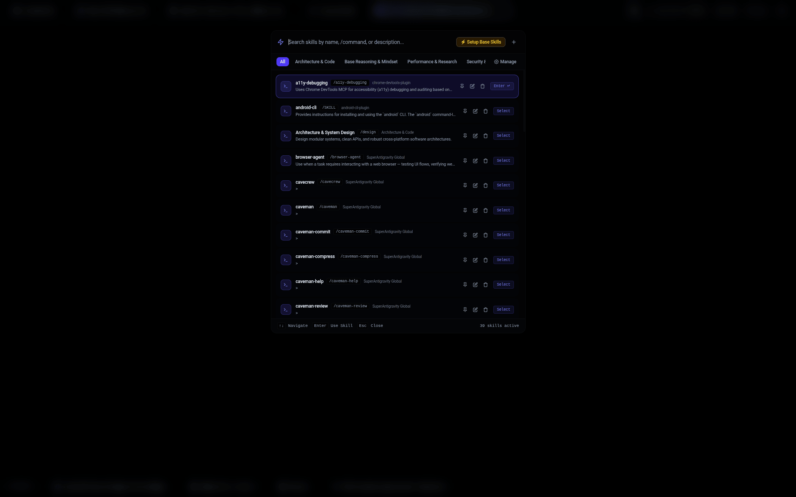

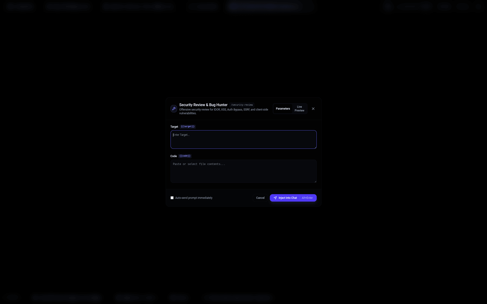

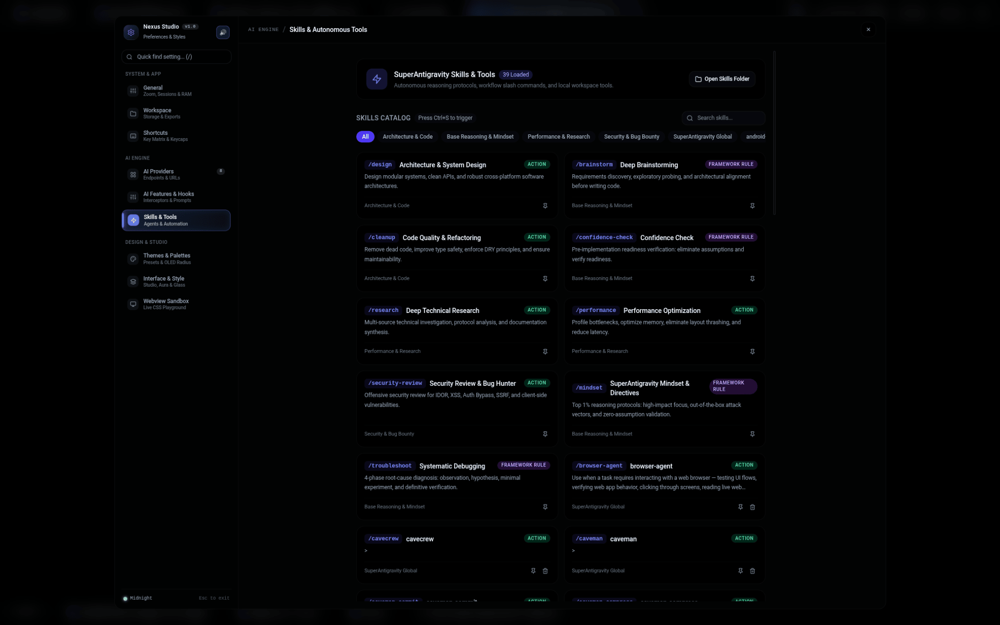

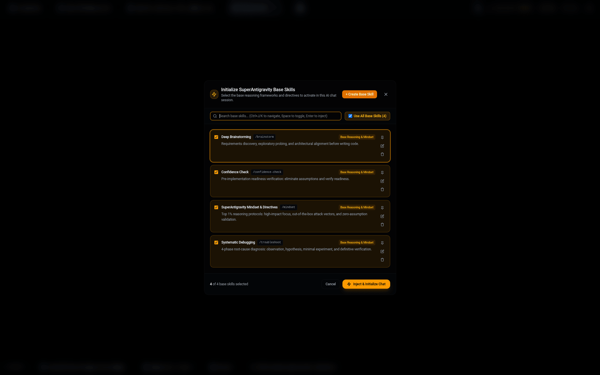

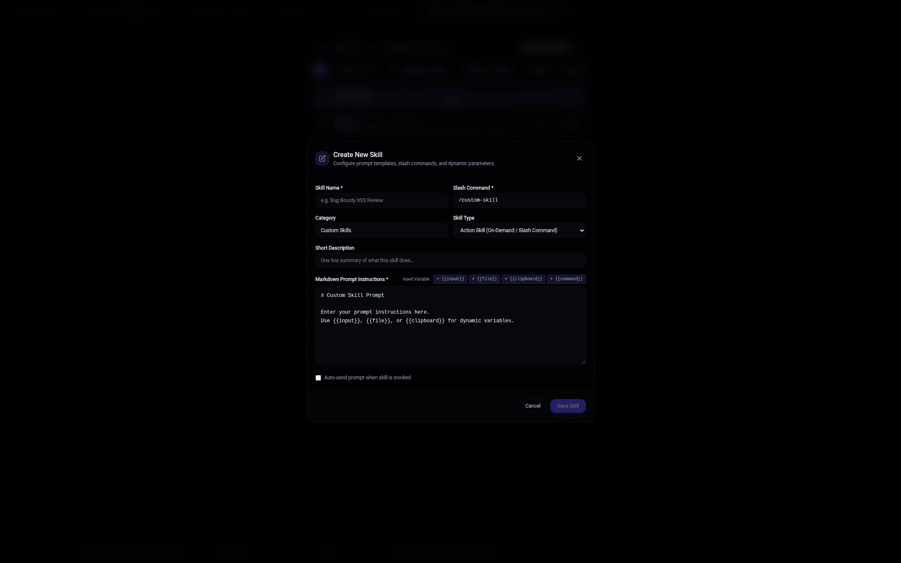

</details>

<details>
<summary><b>Context handoff export</b> — move a conversation to another model without losing the thread</summary>

<br />

`Ctrl+Shift+E` captures the active conversation and builds a continuation packet.

Three modes:

| Mode | Best for |
| --- | --- |
| **Continuation Brief** | Structured summary with objective, provenance, artifacts, and transcript |
| **Faithful Transcript** | Exact turns, code, and links with nothing paraphrased |
| **High-Density Pack** | Maximum evidence, minimum prose |

Options let you deduplicate identical code blocks, strip greetings and pleasantries, and include the reasoning summary. Copy the packet straight into another provider, or download it as a `.md` file.

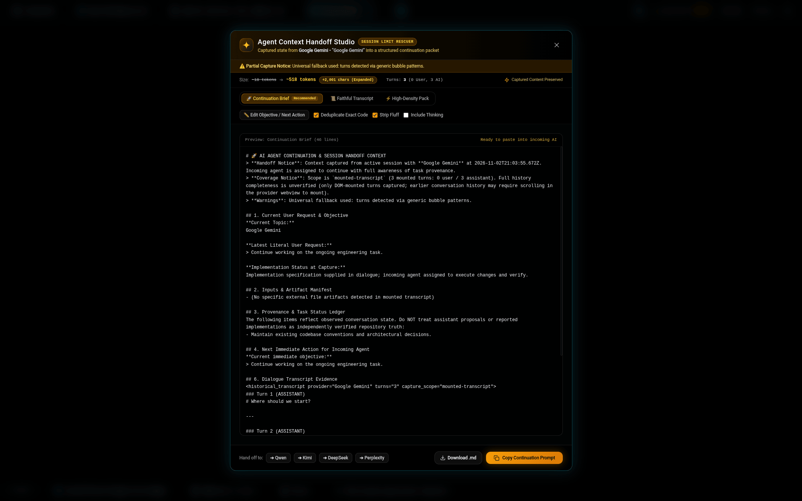

</details>

<details>
<summary><b>File &amp; folder uploads</b> — send codebases, not just single files</summary>

<br />

- `Ctrl+O` uploads one or more files to the active AI page.
- `Ctrl+Shift+O` scans an entire folder and opens a filter modal before upload.
- Unsupported text formats are automatically masqueraded as `.txt` so the provider accepts them.
- Folder scans build a hierarchical tree, skip noise, cap at 10,000 files, and split oversized payloads into chunks.
- PDFs and binary files are passed through as native attachments.

</details>

<details>
<summary><b>Downloads</b> — everything lands in one place</summary>

<br />

Files downloaded from any AI page go to `Downloads/nexus` by default. A toast shows progress and gives you **Open** and **Copy path** actions. You can point downloads at an active project folder from the Workspace settings.

</details>

<details>
<summary><b>Themes &amp; Style Studio</b> — make every provider match your setup</summary>

<br />

- **Settings → Themes & Palettes**: presets, accent color, contrast, corner radius, and surface darkness.
- **Settings → Interface & Style**: ambient aura, glassmorphism, bubble style, icon pack, and motion speed.
- **Style Studio**: per-provider theme injection with a live preview.
- **Webview Sandbox**: a live CSS editor with hot reload, a mirror of the active provider, and copy/paste between providers.
- Custom CSS is saved to `customthemes.conf` in your Nexus config folder.

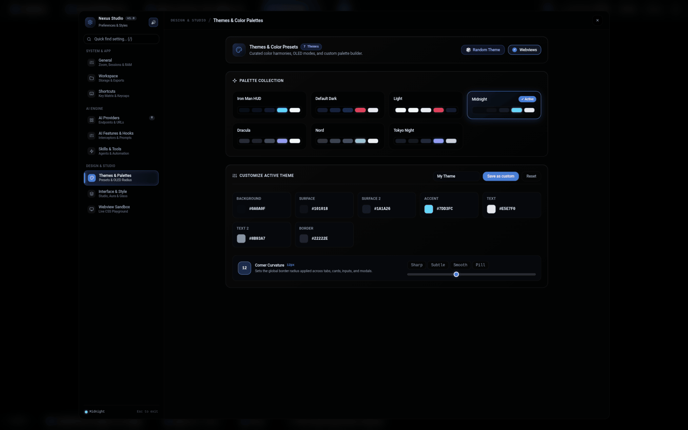

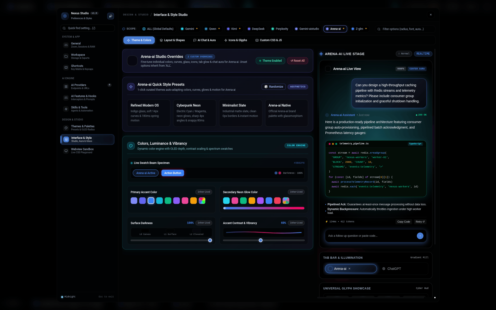

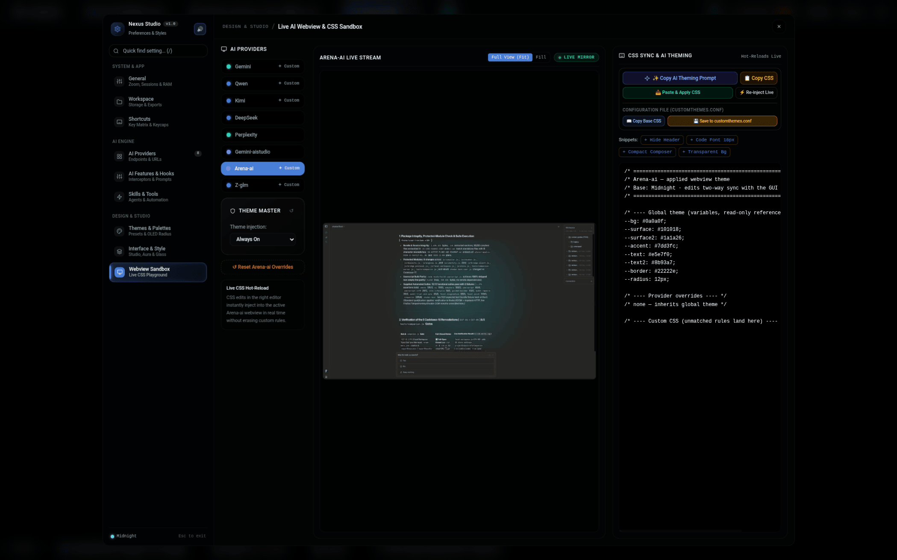

</details>

<details>
<summary><b>Omnibox, history &amp; tab overview</b> — navigate without reaching for the mouse</summary>

<br />

- `Ctrl+L` (or `Ctrl+Shift+P`) opens the omni bar. It fuzzy-matches history, recognizes provider URLs, and falls back to your chosen search engine.
- `Ctrl+H` opens the unified multi-model history.
- `Ctrl+Shift+A` opens tab overview.
- `Ctrl+J` / `Ctrl+K` move to the previous or next tab; `Ctrl+Tab` cycles.

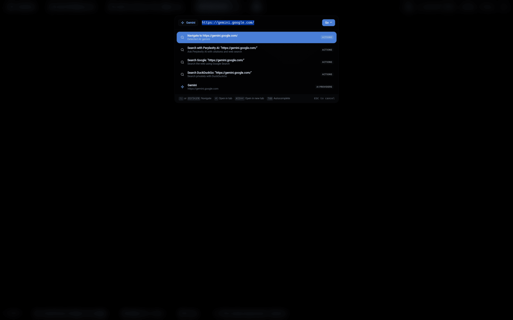

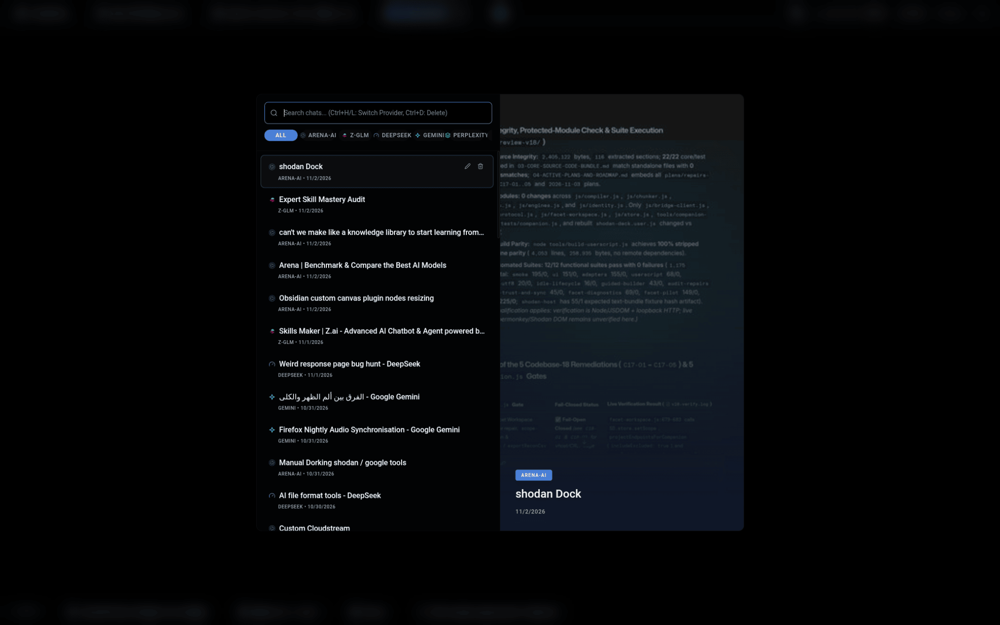

</details>

<details>
<summary><b>Jarvis HUD &amp; onboarding</b> — the cockpit has a personality</summary>

<br />

- Boot sequence, HUD status header, and ambient aura.
- Optional UI sound effects, including the Jarvis-style audio synthesizer.
- The built-in guide (`F1`) covers welcome, style, providers, superpowers, and shortcuts.

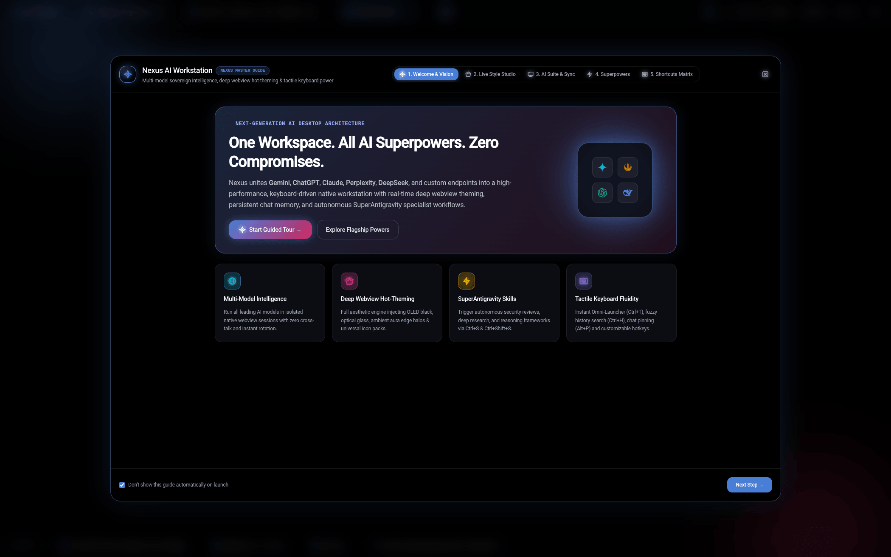

</details>

<details>
<summary><b>Inspector</b> — see exactly what a provider page is doing</summary>

<br />

Every provider page has the full Chromium inspector, even in production builds.

- Right-click anywhere in a provider page → **Inspect Element**.
- Or press `Ctrl+Shift+D` to open DevTools for the active page.

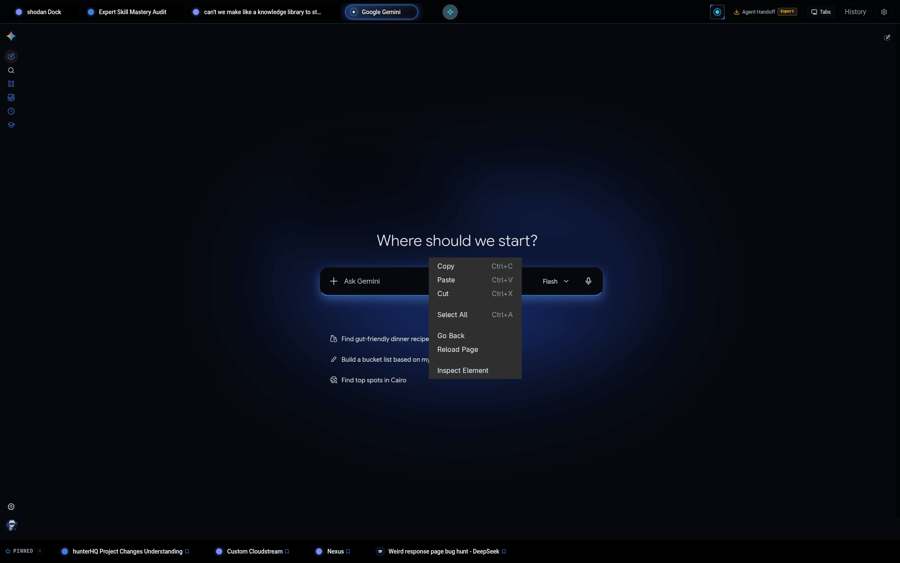

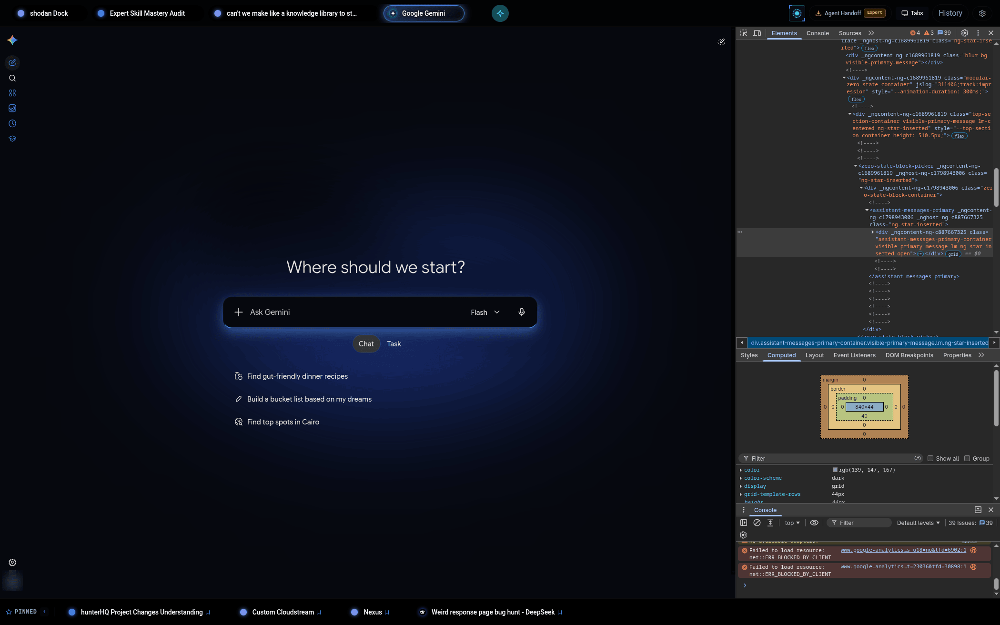

Use it for troubleshooting in [the section below](#troubleshooting).

</details>

---

## Keyboard matrix

| Action | Shortcut |
| --- | --- |
| New AI tab / model launcher | `Ctrl+T` |
| Close active tab | `Ctrl+W` |
| Reopen closed tab | `Ctrl+Shift+T` |
| Pin / unpin active tab | `Alt+P` |
| Tab overview | `Ctrl+Shift+A` |
| Unified history | `Ctrl+H` |
| Omni URL &amp; search bar | `Ctrl+L` or `Ctrl+Shift+P` |
| Previous / next tab | `Ctrl+J` / `Ctrl+K` |
| Cycle next tab | `Ctrl+Tab` |
| Toggle pinned dock | `Ctrl+B` |
| Upload files | `Ctrl+O` |
| Upload folder as codebase | `Ctrl+Shift+O` |
| Next / previous provider | `Ctrl+]` / `Ctrl+[` |
| Reload active AI page | `Ctrl+R` |
| Webview inspector | `Ctrl+Shift+D` |
| Stop generation | `Ctrl+.` |
| Provider's own new chat | `Ctrl+Shift+N` |
| Skills palette | `Ctrl+S` |
| Base skills framework rules | `Ctrl+Shift+S` |
| Settings &amp; Style Studio | `Ctrl+,` |
| Helper guide | `F1` |
| Export context handoff | `Ctrl+Shift+E` |
| Summon Nexus (global) | `Alt+Space` |
| Zoom AI page | `Ctrl+=` / `Ctrl+-` / `Ctrl+0` |
| Zoom Nexus UI | `Ctrl+Shift+=` / `Ctrl+Shift+-` / `Ctrl+Shift+0` |

Every shortcut can be rebound in **Settings → Shortcuts**. The matrix warns you about collisions before you save.

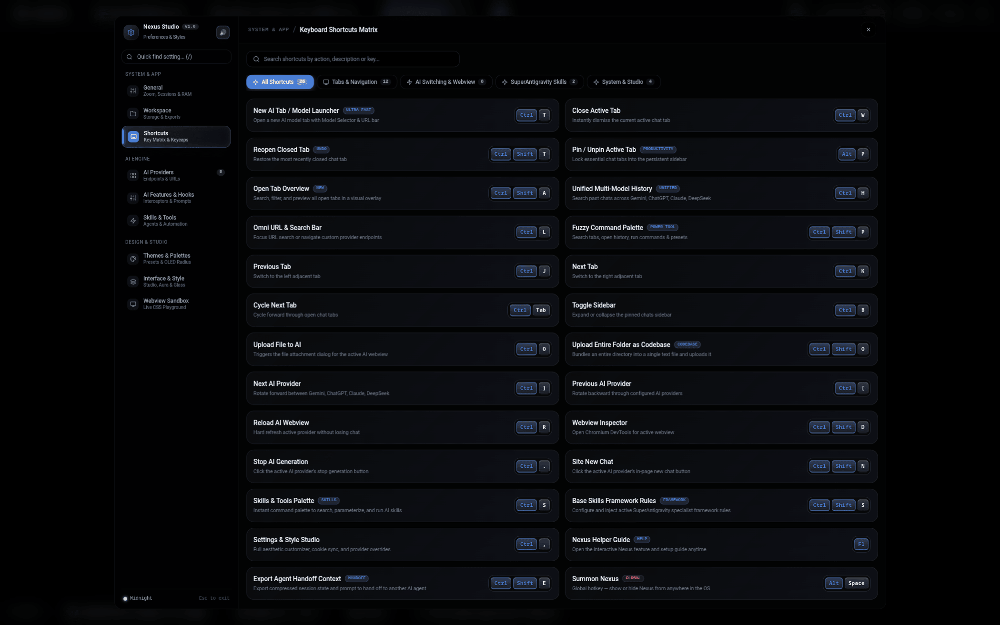

---

## Troubleshooting

Start here. Most problems are one of these six.

<details>
<summary><b>Windows says "Windows protected your PC"</b></summary>

<br />

That is SmartScreen reacting to an unsigned installer.

1. Click **More info**.
2. Click **Run anyway**.
3. Optionally verify the SHA-256 hash shown in [Install on Windows](#install-on-windows).

Nexus does not bundle adware or a third-party updater. The installer is built from this repository's source.

</details>

<details>
<summary><b>I sign in, but the provider forgets me</b></summary>

<br />

Provider sessions live inside Nexus, not in your normal browser.

1. Confirm the provider page is not in a private/incognito state.
2. Close your regular browser completely.
3. Open **Settings → General → Account Sessions & Cookie Sync**.
4. Import the matching browser profile, or paste cookie JSON.
5. Reload the provider with `Ctrl+R`.

If Google blocks embedded sign-in, cookie sync is the intended path — it copies the session your browser already established.

</details>

<details>
<summary><b>A tab is blank, white, or crashed</b></summary>

<br />

1. Press `Ctrl+R` to reload the page.
2. Press `Ctrl+Shift+D` and open the **Console** tab. Look for the first red error.
3. Open the **Network** tab, reload, and look for requests that failed with 4xx/5xx.
4. If the tab was discarded for memory, click it once and give it a moment to wake.
5. If only one tab is broken, close it and reopen the provider with `Ctrl+T`.

</details>

<details>
<summary><b>Nexus is using too much memory</b></summary>

<br />

1. Open **Settings → General → Tab Discard System**.
2. Keep the 10-minute discard timer on.
3. Set **Max active tabs** to `3` or `5` if you routinely keep many tabs open.
4. Pin only the chats you truly need loaded.
5. Close tabs you are done with — `Ctrl+W`.

</details>

<details>
<summary><b>The app stutters or the window is slow</b></summary>

<br />

1. Update your GPU driver first.
2. Try launching with hardware acceleration disabled:
   - Windows: run `nexus.exe --disable-gpu` from `%LOCALAPPDATA%\Programs\nexus`.
3. Reduce ambient aura, glassmorphism, or motion in **Settings → Interface & Style**.
4. Lower the number of active tabs (see above).

</details>

<details>
<summary><b>I installed v1.0.2 but an old version opens</b></summary>

<br />

1. Check the installer filename: it must be `nexus-1.0.2-setup.exe`.
2. Uninstall the old version from **Settings → Apps → Nexus**.
3. Install v1.0.2 again.
4. Your chats and settings live in `%APPDATA%\nexus` and are not removed by an uninstall.

</details>

### Using the inspector

The inspector is the fastest way to turn "it broke" into a fixable bug report.

1. Right-click inside the broken provider page.
2. Choose **Inspect Element**. DevTools opens docked on the right.
3. **Console** — the first red error is usually the cause. Copy the message and the top of the stack trace.
4. **Network** — reload with the panel open. A failed request shows the URL and status code.
5. **Application → Local Storage / Session Storage** — check for the provider's own keys if the page loads but behaves oddly.

**Before you share a screenshot or log, redact:**

- `Authorization` headers, cookies, and session tokens
- API keys and passwords
- Email addresses and account names
- Private chat content you do not want public

If a page is broken before you can right-click it, use `Ctrl+Shift+D` instead.

### What to include in a bug report

- Nexus version (`v1.0.2`) and your OS
- Which provider and URL
- Exact steps to reproduce
- The first console error, with secrets removed
- A screenshot if the issue is visual

Open an issue: [github.com/a1sadeq/nexus/issues](https://github.com/a1sadeq/nexus/issues)

---

## Settings map

| Section | What lives there |
| --- | --- |
| **General** | UI and webview zoom, session sync, pinned dock position, tab discard, max active tabs |
| **Workspace** | Storage, exports, skills folder, download location |
| **Shortcuts** | Full keyboard matrix, rebinding, collision warnings |
| **AI Providers** | Provider list, URLs, colors, icons, add/remove |
| **AI Features &amp; Hooks** | DOM selectors, title sync, prompt navigation, auto-submit, custom scripts |
| **Skills &amp; Tools** | Skill catalog, categories, pinning, editor |
| **Themes &amp; Palettes** | Presets, accent, contrast, radius, OLED surfaces |
| **Interface &amp; Style** | Aura, glass, bubbles, icons, motion |
| **Webview Sandbox** | Live CSS editor, mirror, hot reload, `customthemes.conf` |

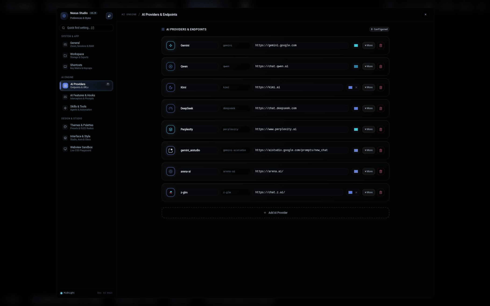

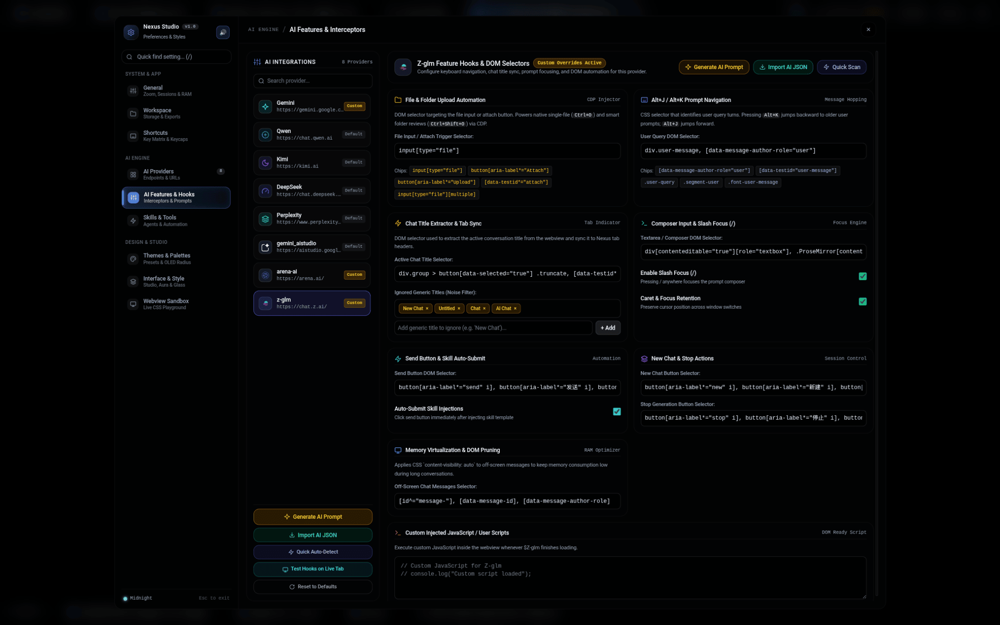


---

## Tech stack

Electron 43 · React 19 · TypeScript 5.9 · Tailwind CSS 4 · Vite 7 · Vitest

## Privacy

Nexus renders provider websites directly. Your prompts, files, and sessions go to the provider you are using, not through a Nexus server. Session data stays in your local Nexus profile. Treat that profile like a browser profile: anyone with access to it can access your signed-in accounts.

## Support

- **Bugs and feature requests:** [GitHub Issues](https://github.com/a1sadeq/nexus/issues)
- **Fastest escalation:** **Just call A1sadeq.**

## License

MIT — see [LICENSE](LICENSE).
