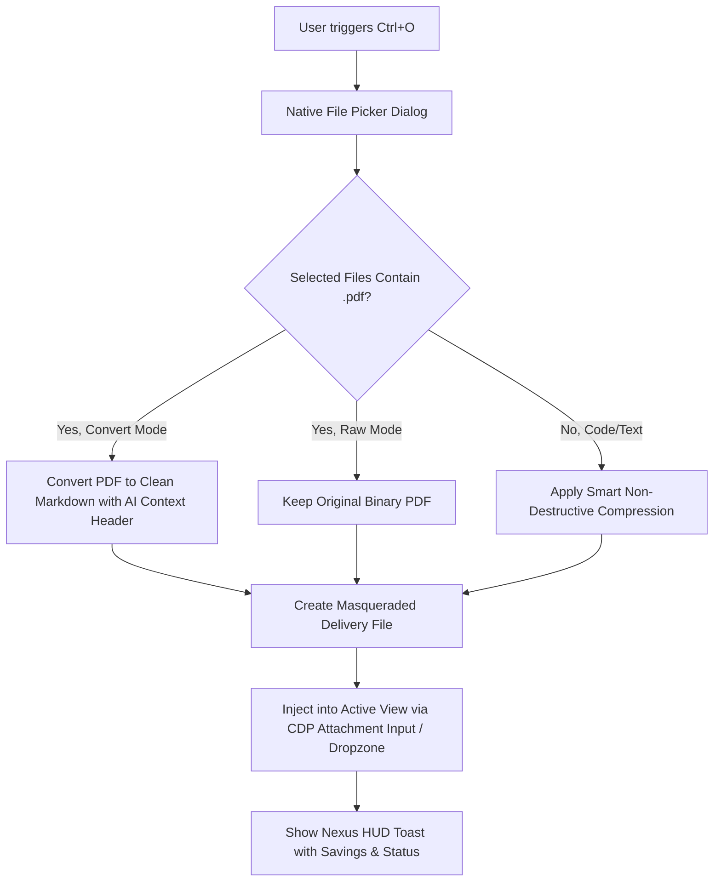

# Task 4: Ctrl+O Single & Multi-File Instant Conversion & Injection Pipeline

**File:** `docs/plans/2026-10-30-ctrl-o-single-multi-file-pipeline-plan.md`  
**Related Components:** `src/main/uploadManager.ts`, `src/main/index.ts`, `src/renderer/src/components/ProviderFeaturesSection.tsx`

---

## 1. Objective

Enhance the `Ctrl+O` shortcut (Single and Multi-File Upload) so that selecting `.pdf` documents or text/code files instantly optimizes them for AI consumption:
- Automatically converts `.pdf` files to semantic `.md` with an AI context header.
- Applies smart non-destructive compression.
- Masquerades/packages the result as `.txt` or `.md` to bypass AI provider webview upload restrictions.
- Injects the files directly into the active AI provider's attachment input or composer via Chrome DevTools Protocol (CDP).
- Displays a real-time Nexus toast notification with conversion metrics (e.g. `✓ Converted document.pdf → Markdown (Saved 68% bytes)`).
- Supports a raw passthrough option when the user needs to upload the original uncompressed PDF.

---

## 2. Requirements & Workflow



---

## 3. Implementation Details

1. **Native Dialog Filters**:
   - Update `dialog.showOpenDialog` in `handleFileUpload`:
     ```typescript
     filters: [
       { name: 'Supported Files (*.pdf, *.ts, *.js, *.py, *.md, *.txt, ...)', extensions: ['*'] }
     ]
     ```
2. **Automated Conversion & Toast Notification**:
   - When a `.pdf` is detected:
     - Run `convertPdfToMarkdown(filePath)`.
     - Create masqueraded `.txt` / `.md` in temp storage with source header.
     - Emit HUD toast: `showNexusToast(view, `✓ Converted ${fileName} to Markdown (-${reduction}%)`)`.
3. **CDP Injection Resilience**:
   - Use existing multi-tier delivery in `uploadManager.ts`:
     1. CDP `DOM.setFileInputFiles` on provider's attachment selector.
     2. Drag-and-drop event emulation onto chat dropzone.
     3. Fallback to pasting formatted text into composer with warning if file inputs are disabled.

---

## 4. Verification & Testing Criteria

- Verify `Ctrl+O` file picker accepts `.pdf` files.
- Verify that selecting a 5MB PDF instantly converts to Markdown (< 500KB) and injects into the webview file input.
- Verify toast notification accurately displays file conversion and savings percentage.
- Verify raw file passthrough works when configured in settings.
