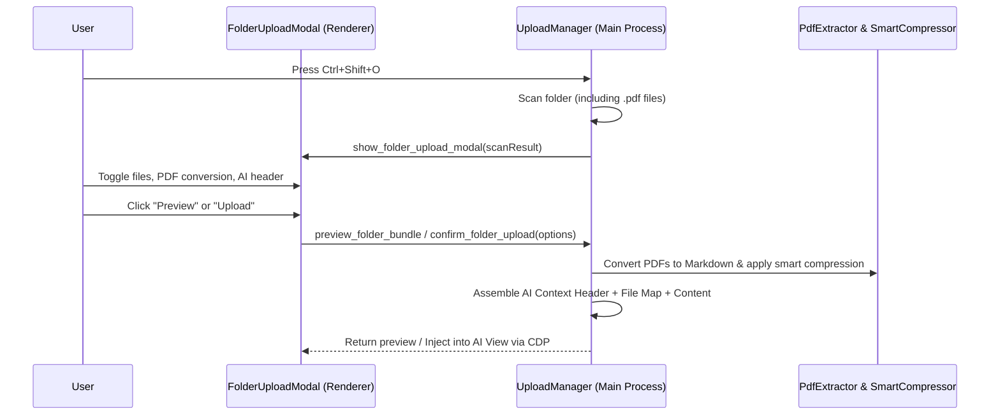

# Task 3: Ctrl+Shift+O Folder Ingestion & Modal Integration

**File:** `docs/plans/2026-10-30-ctrl-shift-o-folder-modal-integration-plan.md`  
**Related Components:** `src/renderer/src/components/FolderUploadModal.tsx`, `src/renderer/src/lib/folderUploadHelpers.ts`, `src/main/uploadManager.ts`, `src/shared/folderUpload.ts`

---

## 1. Objective

Integrate PDF conversion, AI context header generation, and smart non-destructive file compression into the `Ctrl+Shift+O` (Folder Upload / Codebase Ingestion) experience.

---

## 2. Requirements & UI/UX Design

1. **Scanner Inclusion**:
   - Remove `.pdf` from `BINARY_EXTENSIONS` in `uploadManager.ts`.
   - Scan `.pdf` documents alongside source files, calculating original size and previewing them with a distinct badge.
2. **Interactive Controls in `FolderUploadModal`**:
   - **AI Context Header Toggle**: Checkbox (default: `ON`) with tooltip explaining the ingestion protocol and file map.
   - **Smart Code Compression Toggle**: Checkbox (default: `ON`) with real-time stats showing saved tokens/bytes.
   - **PDF Conversion Mode**:
     - Mode A: Convert to Markdown (Default, recommended for AI ingestion).
     - Mode B: Raw PDF Passthrough (Keep original binary `.pdf` intact).
   - **Scanned File Types Filter**: Include `.pdf` as a filter pill (`.pdf [N]`), allowing bulk toggle of PDF documents.
3. **Live Bundle Preview & Partitioner**:
   - Preview drawer displays the full generated AI Context Header, followed by the smartly compressed file bodies and converted PDF markdown.
   - Chunks & Partition Manager calculates chunk sizes using the post-conversion Markdown and compressed sizes, allowing accurate multi-part chunking within LLM token limits (e.g. 8MB chunks).

---

## 3. Data Structures & IPC Flow

---

## 4. Verification & Testing Criteria

- Test folders containing mixed code (`.ts`, `.py`, `.json`) and PDFs (`.pdf`).
- Verify that PDF files can be selected, deselected, and filtered via UI pills.
- Verify that bundle preview renders the AI Context Header, file index, and converted markdown.
- Verify downloading bundle (`.txt`) saves the complete optimized text package.
- Verify partitioning splits large bundles cleanly without breaking markdown headings or code fences.
