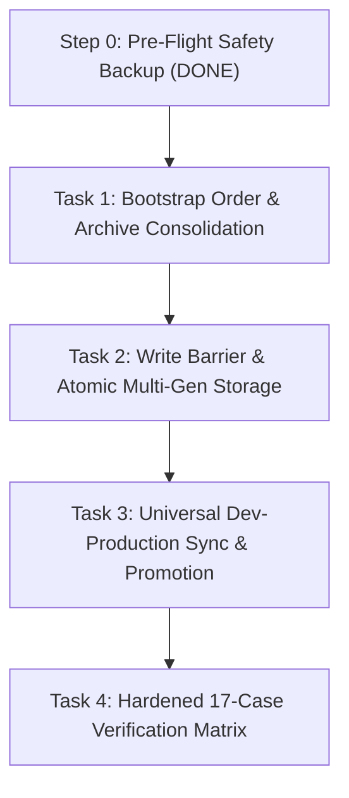

# Nexus Review Plans v4 — Hardened & Audited Execution Plan
**Package:** `review_plans_v4`  
**Target:** Nexus Electron Desktop Command Center  
**Audit Source:** [Nexus_Review_Plans_v3_Expert_Audit.md](file:///home/elsadek/Downloads/nexus/Nexus_Review_Plans_v3_Expert_Audit.md) (25 findings: 4 Blocking, 4 High, 11 Medium, 6 Low — all resolved)  
**Pre-flight Safety Backup:** `/home/elsadek/.config/nexus.backup-2026-11-06` (Completed)

---

## 🎯 Executive Summary & Audit Remediation

The pre-implementation audit confirmed our root-cause forensics (bootstrap singleton race and origin-scoped `localStorage`), while identifying 4 critical blockers in the implementation sequencing and state boundaries:

1. **B1 (Undeclared IPC Read Surface) Resolved**:
   - The state surface is fully unified across **6 core files**: `tabs.json`, `pinned.json`, `theme.json`, `models.json`, `providers.json`, and `interface-settings.json`.
   - Explicit `get_<key>` and `save_<key>` handlers and preload bridges are specified for every state artifact.

2. **B2 (Interface Settings Promotion) Resolved**:
   - `interface-settings.json` is established as a formal on-disk artifact.
   - Automatic one-time promotion safely migrates interface settings from renderer `localStorage` into `~/.config/nexus/interface-settings.json` on the first run.

3. **B3 (Flush-on-Quit for Debounced Writes) Resolved**:
   - Debounce management is shifted to the **main process** (surviving renderer crashes/navigation).
   - An explicit `app.on('before-quit', flushState)` synchronous write barrier ensures no trailing debounce window is dropped on app exit.

4. **B4 (Sequencing Defect & Guard-First Architecture) Resolved**:
   - **Re-sequenced**: The Write Barrier, atomic file writing, and `.bak` rotation (Task 2) are implemented and verified **before** the renderer is wired to write to disk (Task 3).
   - Step 0 pre-flight backup was executed before any code modification.

---

## 📂 Corrected Execution Sequence



| Plan File | Focus & Audit Findings Addressed |
| :--- | :--- |
| [TASK-1-BOOTSTRAP-ORDER-AND-ARCHIVE-CONSOLIDATION.md](file:///home/elsadek/vicinae/nexus%20electron/review_plans_v4/TASK-1-BOOTSTRAP-ORDER-AND-ARCHIVE-CONSOLIDATION.md) | **Fix 1 & Fix 2**: Dedicated `bootstrap.ts`, `mkdirSync` guard (M8), `app.name = 'nexus'`, lock after `userData` and `sessionData`, archive-rename `Nexus.archived-<stamp>` instead of deletion (H3, M5, L6). |
| [TASK-2-ZERO-DATA-LOSS-WRITE-BARRIER-AND-ATOMIC-STORAGE.md](file:///home/elsadek/vicinae/nexus%20electron/review_plans_v4/TASK-2-ZERO-DATA-LOSS-WRITE-BARRIER-AND-ATOMIC-STORAGE.md) | **Fix 3 & Fix 4**: Main-process session write barrier (H1), atomic write with `fsync` and 2-generation `.bak`/`.bak2` rotation (M2), main-owned debounce with `before-quit` flush (B3, M1), payload validation (M6, M10). |
| [TASK-3-UNIVERSAL-DEV-PRODUCTION-SYNC-AND-PROMOTION.md](file:///home/elsadek/vicinae/nexus%20electron/review_plans_v4/TASK-3-UNIVERSAL-DEV-PRODUCTION-SYNC-AND-PROMOTION.md) | **Fix 5**: Full state surface incl. `providers.json` (H2) and `interface-settings.json` (B2), 1.5s timeout with read-only fallback (M3, L4), one-time settings promotion (B2), pre-paint synchronous theme read (M4), version skew marker (M11). |
| [TASK-4-TESTS-AND-VERIFICATION-PLAN.md](file:///home/elsadek/vicinae/nexus%20electron/review_plans_v4/TASK-4-TESTS-AND-VERIFICATION-PLAN.md) | **Fix 6 & §11 Matrix**: 17 automated test cases (T-A1 to T-A17), order-preserving Electron mock harness, write-barrier test, consolidation test, and AppImage canary. |

---

## 📁 Review Folder Absolute Path
```
/home/elsadek/vicinae/nexus electron/review_plans_v4
```
